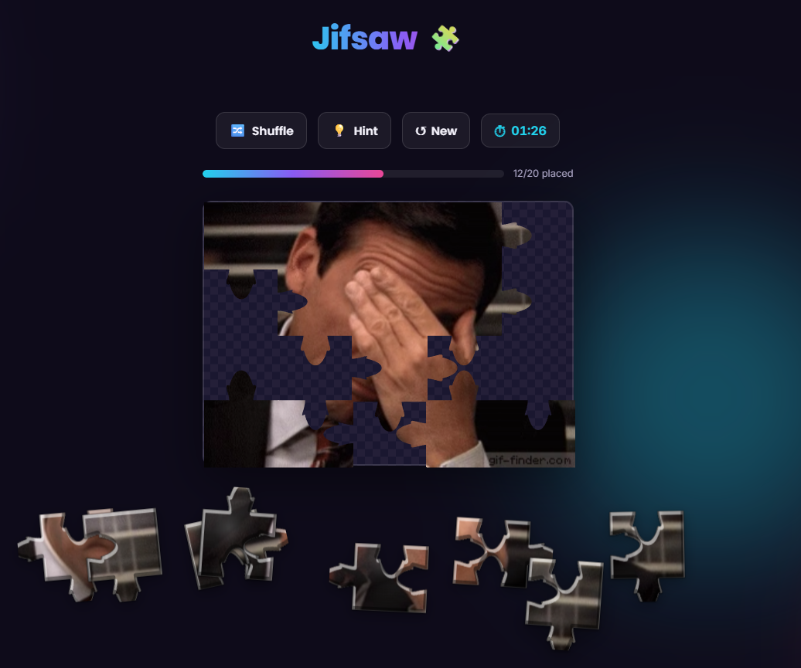
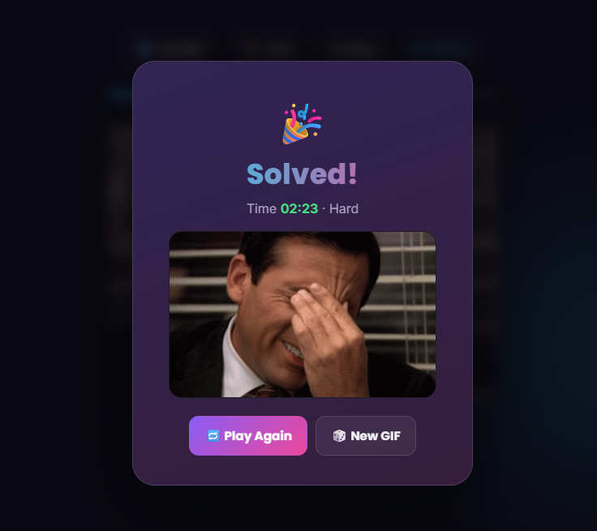

# Jifsaw 🧩

A jigsaw puzzle where the picture is a looping GIF instead of a still image.
Pick a difficulty and a GIF theme, then drag interlocking pieces back together
while the image keeps playing underneath.

**Play it:** https://csvillain.github.io/Jifsaw/

<p>
  
  
</p>

## Running it locally

No build step, no install. Either:

- Open `index.html` directly in a browser, or
- Serve the folder so relative fetches (like `gifs.json`) work over `http://`
  instead of `file://`:

  ```powershell
  python -m http.server 5173
  ```

  then open `http://localhost:5173`.

## How it works

- **Pieces** are cut on an HTML5 `<canvas>` using generated interlocking
  jigsaw-piece paths, sized and cached per piece.
- **The image** is a looping `<video>` element (an mp4 version of the GIF),
  redrawn into each piece every frame — so the puzzle picture keeps playing
  while you solve it.
- **GIFs** currently load live from Giphy through the Cloudflare Worker
  configured in `giphy.js`. The Worker keeps the Giphy API key server-side;
  the browser does not receive the key. The Worker is public, so its shared
  Giphy quota can be consumed by callers outside the game. It applies a
  best-effort limit of 30 requests per minute per client IP and Cloudflare
  location when the rate-limit binding is configured. `gifs.json` remains
  available as a curated pool, but live mode is enabled by default. There is
  no automatic fallback: if the Worker returns 429 or is down, the player
  sees an error. To recover, set `USE_LIVE_API = false` in `giphy.js` and
  redeploy. See [`scripts/refresh-gifs.md`](scripts/refresh-gifs.md) for
  details.

## Testing

Requires Node.js. Install dev dependencies once with `npm install`, then:

- `npm test` — unit tests (Vitest) for the pure logic in `puzzle.js` (piece
  geometry) and `giphy.js` (the random-offset fix that stops repeated GIFs)
- `npm run test:e2e` — Playwright smoke tests against a local static server:
  mobile layout, theme/difficulty controls, full puzzle deal, and the
  New-button reset — covers the real regressions found in earlier sessions

## Stack

Vanilla HTML, CSS, and JavaScript. No framework, no bundler, no dependencies.

- `index.html` / `style.css` — layout and visual design
- `app.js` — UI wiring (difficulty slider, theme picker, game flow)
- `puzzle.js` — piece cutting, rendering, drag/drop and snap-to-place
- `giphy.js` — live Giphy API requests through the configured Worker, with a curated static pool available
- `confetti.js` — win-screen confetti

---

Built by [GTBR](https://gtbr.co.uk/)
